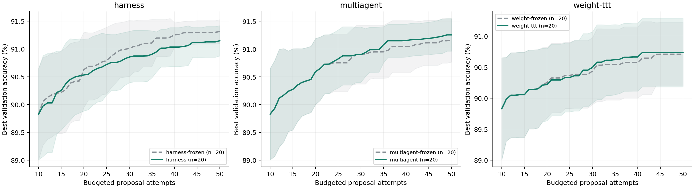

# Self-evolution implementation and measured results

18 November 2026. Implementation commit: [`626becaa`](https://github.com/XjunLi/CSCI5120-GP/commit/626becaa899aea1e0e37196c784dbd681f872d5b). All three layers and their frozen controls are executable. The completed run set contains **128 runs and 6,182 budgeted attempts** on the official normalized NATS-Bench table. Candidate CNNs are not retrained.

## What was implemented

| Layer | Mechanism | Evidence produced |
| --- | --- | --- |
| Harness | Versioned declarative programs, resource-niche memory, interleaved challenger trials, promotion/rollback | Program diffs, parent versions and trial rewards |
| Multi-agent | Proposer–critic rounds, individual memories, directed elite sharing, population replacement and route mutation | Drafts, critiques, agent lineages, genomes and messages |
| Weights | On-policy entropic policy gradients with a reference KL penalty; NumPy policy or actual LM LoRA | Losses, gradients, update count, parameter hashes and L2 changes |

Run instructions and algorithm details: [SELF_EVOLUTION.md](SELF_EVOLUTION.md). Source is under `src/nas_agent_bench/`; the common entry point is `scripts/run_evolution.py`.

## 1. CPU policy comparison: 20 paired seeds

All six conditions use seeds 0–19, 50 attempts per run, and ten shared initial candidates. Harness and multi-agent use explicit local policies; weight conditions use a 405-parameter autoregressive NumPy policy. These are not LLM performance measurements. Scores are mean ± sample SD.

| Method | Validation (%) | CIFAR-10 test (%) |
| --- | ---: | ---: |
| harness-frozen | 91.3125 ± 0.2149 | 94.0203 ± 0.3066 |
| harness | 91.1475 ± 0.2727 | 93.8445 ± 0.3471 |
| multiagent-frozen | 91.1571 ± 0.3933 | 93.9633 ± 0.3302 |
| multiagent | 91.2539 ± 0.2928 | 93.9849 ± 0.2659 |
| weight-frozen | 90.7083 ± 0.5114 | 93.5277 ± 0.5020 |
| weight-ttt | 90.7327 ± 0.5515 | 93.6287 ± 0.4416 |

The matched validation changes (adaptive minus frozen) are:

| Layer | Mean change (pp) | Wins / ties / losses |
| --- | ---: | ---: |
| harness | -0.1650 | 5 / 1 / 14 |
| multiagent | +0.0968 | 8 / 2 / 10 |
| weight-ttt | +0.0245 | 3 / 14 / 3 |

Harness adaptation reduced final performance with these defaults. Multi-agent evolution had a higher mean but won only eight of twenty pairs. NumPy weight adaptation had a small average gain with fourteen ties. The implementation supports real state changes; these measurements do not establish consistent improvement from adaptation.

Across the adaptive CPU runs, the harness completed 100 trials (47 promotions, 53 rejections), multi-agent evolution created 60 descendants, and the NumPy learner executed 200 gradient updates. Frozen controls made no corresponding program, population or weight updates.



The bands show search-run SD, not confidence intervals. [Full report](../results/self_evolution_cpu/EVOLUTION_REPORT.md) · [Machine-readable comparisons](../results/self_evolution_cpu/evolution_summary.json).

## 2. Real Qwen2.5-0.5B LoRA comparison

Three paired seeds (0, 1, 2), **26 attempts** each: ten shared initial candidates and sixteen model-generated architectures. This is a separate budget from the CPU cohort. Each adaptive run executes four gradient updates; its frozen counterpart executes zero. Both use the same fixed prompt and six constrained operation tokens. Validation feedback changes weights and is not inserted into the prompt.

| Method | Validation (%) | CIFAR-10 test (%) | Updates per run |
| --- | ---: | ---: | ---: |
| weight-frozen | 90.9869 ± 0.5621 | 93.7583 ± 0.6350 | 0 |
| weight-ttt | 90.9869 ± 0.5621 | 93.7583 ± 0.6350 | 4 |

The backend updates **270,336 LoRA parameters in 48 q/v modules**, with rank 4 and alpha 8. The base language-model weights stay fixed. Actual adapter L2 changes were:

| Seed | Adaptive weight change | Frozen weight change |
| --- | ---: | ---: |
| 0 | 0.130160 | 0.000000 |
| 1 | 0.097673 | 0.000000 |
| 2 | 0.114764 | 0.000000 |

Parameter hashes changed in all adaptive runs and stayed identical in every frozen run. The two conditions selected the same winner for each seed; every winner came from the shared initialization. Therefore this run establishes functional online LoRA learning but **no NAS-quality gain** at this budget. Average runner time was 78.3 seconds adaptive versus 31.8 seconds frozen, including checkpoint writing but excluding initial model loading.

[Full LoRA report](../results/self_evolution_lora/EVOLUTION_REPORT.md) · [Machine-readable results](../results/self_evolution_lora/evolution_summary.json).

## 3. Real-model interface check for harness and multi-agent

The same Qwen0.5B checkpoint was also used through the free-text JSON adapter with `configs/llm_smoke.json`: one seed, thirteen attempts per method, including ten initial candidates. This checks the complete model interface, not comparative search quality.

- Harness: four model calls (one program edit plus three architecture proposals). The program edit failed the schema and fell back to a logged bounded local mutation; all three proposed architectures were invalid. The challenger trial was rejected.
- Multi-agent: six model calls (three proposer–critic pairs), two valid final architectures and one invalid final architecture; one population replacement completed.

The small model did not reliably follow the full free-text schemas. Its LoRA backend uses constrained action decoding and had no invalid architectures. The same harness/multi-agent interface accepts larger local models or a user-configured chat-completions service through `adapters/evolution/openai_compatible.py`.

[Model interface logs and report](../results/self_evolution_llm_smoke/EVOLUTION_REPORT.md).

## Verification and reproducibility

- **50 automated tests passed** in the PyTorch environment, including numerical gradient checks, actual LoRA backward, frozen-base identity, exact optimizer/RNG restoration, JSON failures, budget accounting and validation-only boundaries.
- The HTTP adapter passed proposal, harness-edit and peer-critique checks against a local mock endpoint. No hosted model API was called.
- All committed source fingerprints match the files used by the experiments. All paired initial candidates match. Every frozen weight checkpoint has zero parameter change.
- Each run saves its trajectory, events, settings and final selection. Large local checkpoints are regenerated by the runner and are not needed to read or aggregate the committed results.
- All requested searches completed and their winners were locked before the held-out test lookup. CIFAR-100/ImageNet16-120 entries in the machine-readable reports are separately trained evaluations of the selected architecture.

CPU runtime: Python 3.12.14, NumPy 2.3.5. LM runtime: Python 3.12.14, NumPy 2.5.5, PyTorch 2.6.0+cpu, Transformers 4.57.1, safetensors 0.8.0; two CPU threads. Model/checkpoint content hashes are in the saved configurations and checkpoints.

```bash
python scripts/summarize_evolution.py \
  results/self_evolution_cpu results/self_evolution_lora \
  results/self_evolution_llm_smoke --plot
```

## TTT reference

[Learning to Discover at Test Time](https://arxiv.org/abs/2601.16175) and its [official code](https://github.com/test-time-training/discover) motivate adapting a generative policy to feedback from the current problem. This implementation uses finite-batch mean-baselined entropic gradients and omits PUCT reuse; it is a NAS adaptation rather than a reproduction of the full paper.
