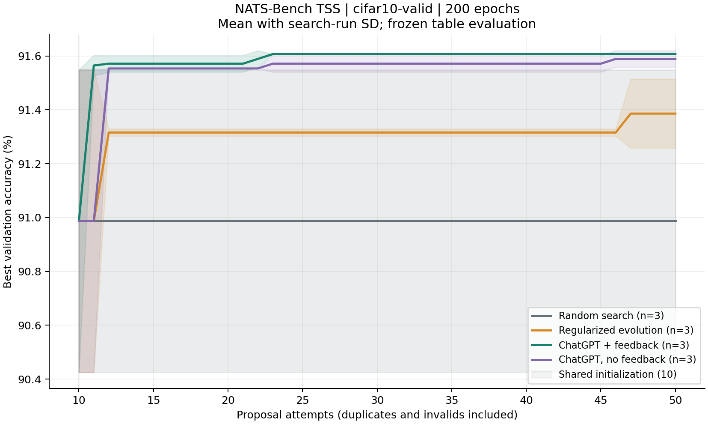

# NAS Agent 项目阶段报告

日期：2026-11-17

## 本轮完成了什么

已完成真实 NATS-Bench 表格环境、Random Search、正则化进化搜索、冻结 ChatGPT 单 agent 搜索，以及有／无反馈消融。共完成 **46 次搜索、2,300 次候选提交**；其中 ChatGPT 在六次独立运行中逐步提出 **240 个候选**。代码、逐步轨迹、配置、锁定的最终架构和测试结果均保存在仓库中。

核心结果是：ChatGPT 在这个搜索空间中能够迅速提出高性能架构，但**无反馈条件几乎达到相同成绩**。本轮证明了实验闭环可运行，也确定了下一阶段需要解释的问题：改进来自模型已有的结构知识，还是来自搜索过程中使用反馈的能力？

## 1. NAS 表与实验协议

NATS-Bench TSS 为固定四节点 cell 的六条边各指定一种操作，共有五种操作、$5^6=15,625$ 种编码。每个编码在固定网络与训练设置下已有真实训练记录，因此本轮通过 CPU 查询记录即可评价候选，无需重新训练图像分类网络。托管 ChatGPT 的推理仍消耗服务端算力；本轮没有训练 CNN 或更新 LLM 权重。[官方说明](https://github.com/D-X-Y/NATS-Bench)与[论文](https://arxiv.org/abs/2009.00437)给出了空间和数据定义。

例如，用户给出的六操作配置，其 CIFAR10 验证准确率为 **89.124%**、测试准确率为 **92.260%**，计算量为 **82.49409 MFLOPs**、参数量为 **0.587386 M**。详细编码见 [example_architecture.json](example_architecture.json)。搜索方法的任务是在有限查询次数内找到更好的配置；完整表由评价端持有。

本轮统一使用 `cifar10-valid` 的 `valid-accuracy`，训练长度为 `hp=200`；`is_random=False` 对该配置可用的官方训练运行取均值，记录通常包含两次或三次训练。这里的训练重复与搜索 seed 是两层不同的随机性。每次搜索有 50 次提交，其中前 10 次是共享随机初始化；无效或重复提交同样消耗预算。进化搜索采用种群 10、锦标赛 3、单边操作突变与按年龄淘汰。

同一 seed 下，四种方法共享完全相同的十个初始架构。有反馈 ChatGPT 可见验证分数和成本；无反馈 ChatGPT 在整个搜索过程中均看不到这些数值，包括初始化分数。**无反馈条件结束后，评价端仍从其 50 个候选中按验证分数选最优项**，因此这项消融检验的是“反馈是否帮助模型提出候选”。所有运行先锁定验证最优架构，再统一查询测试分数；测试分数未进入搜索轨迹。

数据来自官方 `NATS-tss-v1_0-3ffb9-simple.tar`，使用 `nats-bench 1.8`。源压缩包 SHA256 为：

```text
580fd8f3425fed9f495640b0f12ccb7744f89dec7aff263bd75aed37ab0b8bb6
```

完整规则见[实验协议](../docs/EXPERIMENT_PROTOCOL.md)和[ChatGPT 提案协议](../docs/CHATGPT_PROPOSER_PROTOCOL.md)。

## 2. 主要结果：相同三个 seed 的配对比较

下表均为搜索 seed 0、1、2 的均值 ± 样本标准差，单位为百分比。测试列评价的是验证集选出的架构。CIFAR100 和 ImageNet16-120 使用该架构在对应数据集上独立训练的官方结果。

| 方法 | 运行数 | CIFAR10 验证 | CIFAR10 测试 | CIFAR100 测试 | ImageNet16-120 测试 |
|---|---:|---:|---:|---:|---:|
| Random Search | 3 | 90.987 ± 0.562 | 93.758 ± 0.635 | 71.580 ± 1.604 | 44.839 ± 0.875 |
| 正则化进化搜索 | 3 | 91.386 ± 0.128 | 94.123 ± 0.190 | 72.479 ± 0.750 | 45.700 ± 0.807 |
| ChatGPT，有反馈 | 3 | **91.607 ± 0.000** | **94.373 ± 0.000** | 73.220 ± 0.000 | **46.711 ± 0.000** |
| ChatGPT，无反馈 | 3 | 91.589 ± 0.031 | 94.370 ± 0.006 | **73.318 ± 0.169** | 46.589 ± 0.212 |



图从第 10 次提交开始展示，前十次初始化仍计入总预算。逐次数据与汇总见 [aggregate_summary.json](aggregate_summary.json) 和 [aggregate_summary.csv](aggregate_summary.csv)。

有反馈相对无反馈，最终验证准确率仅提高 **0.0177778 个百分点**，CIFAR10 测试仅提高 **0.0033333 个百分点**；差异全部来自 seed 0。六次 ChatGPT 搜索提出的新候选均合法且在各自运行内不重复，合法率与运行内唯一率均为 **100%**。

探索性地计算第 11–50 次提交的平均 incumbent，即每一步截至当时的最优验证分数：有反馈为 **91.596278%**，无反馈为 **91.553839%**，相差 **0.0424389 个百分点**。有反馈三次运行均在第 11 步达到 91.5%，无反馈均在第 12 步达到。在这六条轨迹中，有反馈条件的早期分数略高；这项事后轨迹分析作为补充指标报告。

## 3. 较大重复数的 baseline

为检查 baseline 稳定性，两种传统方法各额外扩展到 seed 0–19；这张表与上面的配对三次比较分开报告。

| 方法 | 运行数 | CIFAR10 验证 | CIFAR10 测试 | 平均唯一评价数 | 平均重复提交数 |
|---|---:|---:|---:|---:|---:|
| Random Search | 20 | 90.750 ± 0.439 | 93.568 ± 0.356 | 50.00 | 0.00 |
| 正则化进化搜索 | 20 | 91.020 ± 0.500 | 93.870 ± 0.394 | 45.75 | 4.25 |

进化搜索的平均验证成绩高出随机搜索 **0.271 个百分点**。重复突变被计入预算，因此进化搜索的有效唯一评价数更少。

## 4. 锁定搜索后的全表核验

全部搜索结束、最终架构锁定后，评价端对完整官方表进行了排名核验。核验确认：在本轮 `cifar10-valid / hp=200 / 可用训练运行均值` 定义下，唯一最高验证分数为 **91.60666665039064%**，对应 benchmark index **6111**：

```json
{
  "ops": [
    "nor_conv_3x3", "nor_conv_3x3", "nor_conv_3x3",
    "skip_connect", "nor_conv_3x3", "nor_conv_1x1"
  ]
}
```

三次有反馈搜索均找到验证排名第一的编码；无反馈 seed 0 找到第二名，其余两次也找到第一名。该全表排名是**事后评价结果**，未作为搜索反馈，也不意味着此编码的测试分数为全空间最高。详细记录见 [global_rank_audit.json](global_rank_audit.json)。有反馈组标准差为零，是因为三次选中了相同架构，且评价表取固定均值。

## 5. 目前的实现边界与下一步

当前已经实现的是固定实验 harness 与冻结 LLM 的单 agent 架构搜索。并行运行的 agent 分别承担独立重复实验，没有共享搜索状态，因此尚未实现多 agent 协同进化。Harness 自修改、搜索策略程序的进化与 LoRA／权重进化也尚未实现。Qwen2.5-0.5B CPU 适配器已完成加载和格式测试；本报告的 LLM 实验使用 ChatGPT，未以小模型结果替代。

本轮仅有三个 LLM 搜索重复；模型的精确 API revision、温度与内部采样 seed 未向运行环境公开。轨迹可核查，模型采样不可保证逐字复现。数值标准差描述搜索重复间的差异，不是置信区间。信息隔离由提案协议与反馈过滤实现，当前不等于操作系统级沙箱。

下一步先固定受约束的任务，例如设置 FLOPs 或参数预算，再让 harness 的单一机制发生可审计改变：候选生成、历史摘要或探索比例。采用相同查询预算和共享初始化，对比固定 harness 与可修改 harness，检验是否存在明确的反馈收益。第二阶段再引入 agent 角色分工、消息与共享记忆的消融；第三阶段考虑权重更新及其独立训练成本。这样每一阶段都能回答新增机制是否带来收益。

## 明天可以直接汇报的三句话

我们已经搭好基于真实 NATS-Bench 数据的完整实验环境，完成了随机搜索、进化搜索和 ChatGPT 搜索，所有方法都在验证集上选择架构，测试集只用于最终报告。

在三个共享初始化的重复实验中，ChatGPT 有反馈搜索都找到了本协议下的全空间验证最优架构，但无反馈版本也几乎达到相同成绩，说明结构先验已足以产生很强的候选。

下一步将加入资源约束，并分别改变 harness 的具体机制，再决定如何扩展到多 agent 协作与权重进化。
