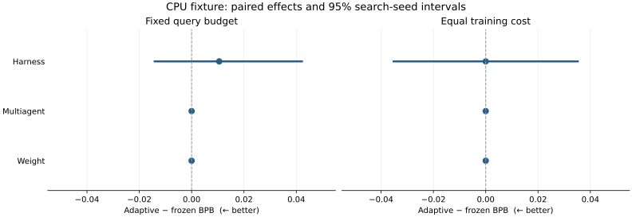

# CPU protocol experiment

## Result

The complete pipeline ran on an authored text fixture with actual tiny-Transformer training, compressed-model reload, measured-table search and fresh-seed confirmation. This cohort does not show a stable advantage from retaining adaptive updates over the matched frozen controls. Its scores are a protocol check; they are not FineWeb, H200 or pretrained-LM performance.

## Coverage and cost

| Item | Recorded value |
| --- | --- |
| Configurations | 24 |
| Training seeds | [0, 1, 2] |
| Table-construction training jobs | 72 |
| Sum of optimizer/training time | 13.487769 s |
| Sum of per-job end-to-end time | 18.513351 s |
| Search replays | 480 |
| Fixed-query allowance | 12 attempts, including 4 common initial configurations |
| Equal-cost allowance | 6.743885 measured training seconds |

Replay costs represent the candidate-training time that online search would have consumed. The models are trained once to construct the table; replaying a lookup is not another training job.

Each CPU training job completed 40 optimizer steps. The 10-second cap was a guard, not a claim that each CPU job trained for 10 seconds. GPU jobs instead target approximately 600 seconds on one H200.

## Best observed search BPB

Lower is better. Each cell is the mean across paired search seeds on the same fixed table. All methods use the same initial configurations for a given seed.

| Method | Fixed-query mean | Fixed-query optimum hits | Equal-cost mean | Equal-cost mean attempts |
| --- | ---: | ---: | ---: | ---: |
| `random` | 3.735204 | 12/30 | 3.769103 | 11.60 |
| `evolution` | 3.596776 | 25/30 | 3.617852 | 11.60 |
| `harness-adaptive` | 3.606087 | 24/30 | 3.627274 | 11.53 |
| `harness-frozen` | 3.595549 | 25/30 | 3.627274 | 11.60 |
| `multiagent-adaptive` | 3.577948 | 27/30 | 3.602611 | 11.37 |
| `multiagent-frozen` | 3.577948 | 27/30 | 3.602611 | 11.37 |
| `weight-adaptive` | 3.716392 | 12/30 | 3.716392 | 11.67 |
| `weight-frozen` | 3.716392 | 12/30 | 3.716392 | 11.57 |

The measured table optimum is **3.553285 BPB**. This value is calculated by the analyst after search; controllers do not receive unqueried scores.

## Adaptive versus frozen

Delta is adaptive minus frozen; negative values favor adaptation. Intervals bootstrap paired search seeds. They describe search randomness conditional on this one measured table.

| Budget | Pair | Mean delta BPB | 95% paired interval | Win / tie / loss | Both / adaptive only / control only / neither feasible |
| --- | --- | ---: | --- | --- | --- |
| 12 queries | `harness-adaptive` vs `harness-frozen` | 0.010538 | [-0.014125, 0.042152] | 1 / 27 / 2 | 30 / 0 / 0 / 0 |
| 12 queries | `multiagent-adaptive` vs `multiagent-frozen` | 0.000000 | [0.000000, 0.000000] | 0 / 30 / 0 | 30 / 0 / 0 / 0 |
| 12 queries | `weight-adaptive` vs `weight-frozen` | 0.000000 | [0.000000, 0.000000] | 0 / 30 / 0 | 30 / 0 / 0 / 0 |
| Equal cost | `harness-adaptive` vs `harness-frozen` | 0.000000 | [-0.035201, 0.035201] | 2 / 26 / 2 | 30 / 0 / 0 / 0 |
| Equal cost | `multiagent-adaptive` vs `multiagent-frozen` | 0.000000 | [0.000000, 0.000000] | 0 / 30 / 0 | 30 / 0 / 0 / 0 |
| Equal cost | `weight-adaptive` vs `weight-frozen` | 0.000000 | [0.000000, 0.000000] | 0 / 30 / 0 | 30 / 0 / 0 / 0 |

Exact ties in this finite table do not imply that the methods are equivalent on other tasks. When many runs reach the same table optimum, saturation limits sensitivity to improvements.



## Evidence that adaptation actually executed

| Budget | Harness completed trials / promotions | Multiagent descendants | Weight gradient updates |
| --- | ---: | ---: | ---: |
| replay_attempts | 60 / 30 | 30 | 240 |
| replay_cost | 45 / 21 | 30 | 230 |

| Budget | Pair | Different ordered trajectories | Different queried sets |
| --- | --- | ---: | ---: |
| replay_attempts | harness | 12/30 | 12/30 |
| replay_attempts | multiagent | 22/30 | 20/30 |
| replay_attempts | weight | 9/30 | 7/30 |
| replay_cost | harness | 12/30 | 12/30 |
| replay_cost | multiagent | 19/30 | 18/30 |
| replay_cost | weight | 8/30 | 7/30 |

Changed programs, descendants and nonzero weight updates establish execution of the mechanism. They do not establish a performance benefit. In the CPU cohort the weight policy is a 19-parameter NumPy policy over public design features. The optional causal-LM LoRA path is a separate implementation and is not the source of these replay results.

## Locked-winner confirmation

The 480 locked selections across both replay cohorts reduce to **6 distinct configurations and 18 fresh-seed training jobs**. The confirmation text is separate from search text. Winners were locked before evaluation; no winner was reselected from confirmation scores.

Confirmation training cost: 3.564846 s; summed end-to-end cost: 5.672620 s.

| Candidate | Depth / width / tied / LR scale | Search BPB, seeds 0–2 | Confirmation BPB, seeds 100–102 | Confirmation SD |
| --- | --- | ---: | ---: | ---: |
| `cpu-07eebe56f9a4` | 2 / 32 / False / 1.3 | 4.073886 | 4.127787 | 0.041715 |
| `cpu-1b245bb50d0c` | 1 / 32 / False / 1.3 | 4.010513 | 4.060256 | 0.038192 |
| `cpu-59cc159f14c4` | 3 / 32 / False / 1.3 | 4.157274 | 4.195061 | 0.009096 |
| `cpu-ac775bf3dfda` | 3 / 48 / False / 1.3 | 3.869428 | 3.925336 | 0.018926 |
| `cpu-b543836e46ba` | 1 / 48 / False / 1.3 | 3.553285 | 3.647222 | 0.051943 |
| `cpu-fb3921d96067` | 2 / 48 / False / 1.3 | 3.765157 | 3.815563 | 0.075994 |

Selections without a feasible search winner: 0. Selections whose confirmation cohort is not fully feasible: 0. Score means below are conditional on available confirmation scores.

| Method | Confirmation mean of fixed-query selections | Confirmation mean of equal-cost selections |
| --- | ---: | ---: |
| `random` | 3.803645 | 3.835973 |
| `evolution` | 3.683435 | 3.701976 |
| `harness-adaptive` | 3.691868 | 3.708702 |
| `harness-frozen` | 3.682597 | 3.708702 |
| `multiagent-adaptive` | 3.667715 | 3.688208 |
| `multiagent-frozen` | 3.667715 | 3.688208 |
| `weight-adaptive` | 3.785656 | 3.785656 |
| `weight-frozen` | 3.785656 | 3.785656 |

These method means weight configurations by how often search selected them. Repeated selections share the same three confirmation measurements; they are not independent held-out training repeats. Search-to-confirmation score changes combine a different text subset with new initialization seeds, so they do not isolate either source of variation.

## Provenance and reproducibility

- Table identity: `44d569567c150a918d69044bc60936081260a0bde63040fe5caa6070c0f041d2`.
- Manifest identity: `5027658e68514cfbc46cb407d0725526ba0036e6cebf44cb1ac73ac22dffab7e`.
- Execution fingerprint: `a4929b37f5267ba6b0cf452658244b91ea66b091e9a5023c214f8398d2fb7668`.
- Backend: `cpu_tiny_lm`; hardware class: `CPU`.
- [Measured table](table.json), [fixed-query summary](replay_attempts/summary.json), [equal-cost summary](replay_cost/summary.json).
- Search trajectories and winner locks are retained under this directory. Training records and artifacts are in the originating measurement cohort when a reused table is declared above.

Use the repository runbook to create a fresh result directory when code, data or environment changes. The committed cohorts have matching source snapshots under `source_snapshot/`. Later search changes intentionally require a new replay directory and do not change recorded results.

Regenerate this report with:

```bash
python scripts/golf/report.py --root results/cpu_smoke_20261124 --plot
```
