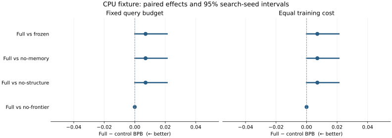

# CPU memory/structure/frontier experiment

## Result

This study evaluates memory/structure/frontier adaptation by replaying a measured table of tiny CPU models trained on an authored text fixture. This cohort does not show a stable advantage from retaining adaptive updates over the matched frozen controls. Its scores are a protocol check; they are not FineWeb, H200 or pretrained-LM performance.

This study reuses the measured table from `../cpu_smoke_20261124/table.json`. It adds **0 model-training runs**.

Earlier confirmation results had already been inspected before this method was developed; this replay is exploratory and does not provide a new untouched confirmation experiment. The H200 task will use its own locked choices and confirmation data.

## Coverage and cost

| Item | Recorded value |
| --- | --- |
| Configurations | 24 |
| Training seeds | [0, 1, 2] |
| Table-construction training jobs | 72 |
| Sum of optimizer/training time | 13.487769 s |
| Sum of per-job end-to-end time | 18.513351 s |
| Search replays | 600 |
| Fixed-query allowance | 12 attempts, including 4 common initial configurations |
| Equal-cost allowance | 6.743885 measured training seconds |

Replay costs represent the candidate-training time that online search would have consumed. The models are trained once to construct the table; replaying a lookup is not another training job.

Each CPU training job completed 40 optimizer steps. The 10-second cap was a guard, not a claim that each CPU job trained for 10 seconds. GPU jobs instead target approximately 600 seconds on one H200.

## Best observed search BPB

Lower is better. Each cell is the mean across paired search seeds on the same fixed table. All methods use the same initial configurations for a given seed.

| Method | Fixed-query mean | Fixed-query optimum hits | Equal-cost mean | Equal-cost mean attempts |
| --- | ---: | ---: | ---: | ---: |
| `random` | 3.735204 | 12/30 | 3.769103 | 11.60 |
| `evolution` | 3.596776 | 25/30 | 3.617852 | 11.60 |
| `memory-frontier-frozen` | 3.553285 | 30/30 | 3.553285 | 11.60 |
| `memory-frontier-memory-only` | 3.553285 | 30/30 | 3.553285 | 11.67 |
| `memory-frontier-structure-only` | 3.553285 | 30/30 | 3.553285 | 12.00 |
| `memory-frontier-frontier-only` | 3.553285 | 30/30 | 3.553285 | 11.57 |
| `memory-frontier-no-frontier` | 3.560348 | 29/30 | 3.560348 | 11.80 |
| `memory-frontier-no-structure` | 3.553285 | 30/30 | 3.553285 | 11.67 |
| `memory-frontier-no-memory` | 3.553285 | 30/30 | 3.553285 | 11.90 |
| `memory-frontier-adaptive` | 3.560348 | 29/30 | 3.560348 | 11.77 |

The measured table optimum is **3.553285 BPB**. This value is calculated by the analyst after search; controllers do not receive unqueried scores.

## Adaptive versus frozen

Delta is adaptive minus frozen; negative values favor adaptation. Intervals bootstrap paired search seeds. They describe search randomness conditional on this one measured table.

| Budget | Pair | Mean delta BPB | 95% paired interval | Win / tie / loss | Both / adaptive only / control only / neither feasible |
| --- | --- | ---: | --- | --- | --- |
| 12 queries | `memory-frontier-adaptive` vs `memory-frontier-frozen` | 0.007062 | [0.000000, 0.021187] | 0 / 29 / 1 | 30 / 0 / 0 / 0 |
| 12 queries | `memory-frontier-adaptive` vs `memory-frontier-no-memory` | 0.007062 | [0.000000, 0.021187] | 0 / 29 / 1 | 30 / 0 / 0 / 0 |
| 12 queries | `memory-frontier-adaptive` vs `memory-frontier-no-structure` | 0.007062 | [0.000000, 0.021187] | 0 / 29 / 1 | 30 / 0 / 0 / 0 |
| 12 queries | `memory-frontier-adaptive` vs `memory-frontier-no-frontier` | 0.000000 | [0.000000, 0.000000] | 0 / 30 / 0 | 30 / 0 / 0 / 0 |
| Equal cost | `memory-frontier-adaptive` vs `memory-frontier-frozen` | 0.007062 | [0.000000, 0.021187] | 0 / 29 / 1 | 30 / 0 / 0 / 0 |
| Equal cost | `memory-frontier-adaptive` vs `memory-frontier-no-memory` | 0.007062 | [0.000000, 0.021187] | 0 / 29 / 1 | 30 / 0 / 0 / 0 |
| Equal cost | `memory-frontier-adaptive` vs `memory-frontier-no-structure` | 0.007062 | [0.000000, 0.021187] | 0 / 29 / 1 | 30 / 0 / 0 / 0 |
| Equal cost | `memory-frontier-adaptive` vs `memory-frontier-no-frontier` | 0.000000 | [0.000000, 0.000000] | 0 / 30 / 0 | 30 / 0 / 0 / 0 |

Exact ties in this finite table do not imply that the methods are equivalent on other tasks. When many runs reach the same table optimum, saturation limits sensitivity to improvements.



## Quality throughout the search

The query metric averages incumbent regret after each adaptive attempt (5–12 in the default plan). The cost metric integrates the incumbent available before the next result arrives, from the common warm-start cost to the cost cap, then divides by that interval. Both use the post-search table optimum; neither exposes it to a controller. Missing feasible incumbents are excluded and counted.

| Method | Query-prefix mean regret | Cost-normalized incumbent regret |
| --- | ---: | ---: |
| `random` | 0.258743 | 0.284727 |
| `evolution` | 0.171046 | 0.214834 |
| `memory-frontier-frozen` | 0.060614 | 0.103817 |
| `memory-frontier-memory-only` | 0.055908 | 0.095822 |
| `memory-frontier-structure-only` | 0.065648 | 0.109155 |
| `memory-frontier-frontier-only` | 0.055446 | 0.100356 |
| `memory-frontier-no-frontier` | 0.060265 | 0.104344 |
| `memory-frontier-no-structure` | 0.069610 | 0.115939 |
| `memory-frontier-no-memory` | 0.062812 | 0.105995 |
| `memory-frontier-adaptive` | 0.061582 | 0.105665 |

| Budget | Pair | Anytime-regret delta | 95% paired interval | Complete pairs |
| --- | --- | ---: | --- | ---: |
| replay_attempts | `memory-frontier-adaptive` vs `memory-frontier-frozen` | 0.000968 | [-0.021734, 0.028221] | 30 |
| replay_attempts | `memory-frontier-adaptive` vs `memory-frontier-no-memory` | -0.001230 | [-0.015934, 0.013351] | 30 |
| replay_attempts | `memory-frontier-adaptive` vs `memory-frontier-no-structure` | -0.008028 | [-0.040485, 0.024742] | 30 |
| replay_attempts | `memory-frontier-adaptive` vs `memory-frontier-no-frontier` | 0.001317 | [0.000000, 0.003952] | 30 |
| replay_cost | `memory-frontier-adaptive` vs `memory-frontier-frozen` | 0.001847 | [-0.022803, 0.031268] | 30 |
| replay_cost | `memory-frontier-adaptive` vs `memory-frontier-no-memory` | -0.000331 | [-0.011671, 0.012101] | 30 |
| replay_cost | `memory-frontier-adaptive` vs `memory-frontier-no-structure` | -0.010275 | [-0.045162, 0.022216] | 30 |
| replay_cost | `memory-frontier-adaptive` vs `memory-frontier-no-frontier` | 0.001321 | [0.000000, 0.003962] | 30 |

## Full-factorial component effects

The eight combinations switch memory organization, structure and frontier adaptation independently. Main effects average over the other two switches. Two-way interactions are differences in differences averaged over the remaining switch; the three-way term is the corresponding third difference. Full-versus-drop-one contrasts above are conditional effects, not these averaged main effects. Intervals below are descriptive, unadjusted for multiple comparisons, on this fixed table.

| Budget | Metric | Factors | Mean effect | 95% paired interval | Complete seed blocks |
| --- | --- | --- | ---: | --- | ---: |
| replay_attempts | anytime_regret | memory | 0.000711 | [-0.008380, 0.009636] | 30 |
| replay_attempts | anytime_regret | structure | 0.002182 | [-0.018126, 0.027525] | 30 |
| replay_attempts | anytime_regret | frontier | 0.001754 | [-0.004170, 0.008597] | 30 |
| replay_attempts | anytime_regret | memory × structure | -0.008035 | [-0.025243, 0.009107] | 30 |
| replay_attempts | anytime_regret | memory × frontier | 0.011511 | [0.000266, 0.024727] | 30 |
| replay_attempts | anytime_regret | structure × frontier | -0.005026 | [-0.019077, 0.007207] | 30 |
| replay_attempts | anytime_regret | memory × structure × frontier | -0.014717 | [-0.042352, 0.009125] | 30 |
| replay_attempts | terminal_bpb | memory | 0.003531 | [0.000000, 0.010594] | 30 |
| replay_attempts | terminal_bpb | structure | 0.003531 | [0.000000, 0.010594] | 30 |
| replay_attempts | terminal_bpb | frontier | 0.000000 | [0.000000, 0.000000] | 30 |
| replay_attempts | terminal_bpb | memory × structure | 0.007062 | [0.000000, 0.021187] | 30 |
| replay_attempts | terminal_bpb | memory × frontier | 0.000000 | [0.000000, 0.000000] | 30 |
| replay_attempts | terminal_bpb | structure × frontier | 0.000000 | [0.000000, 0.000000] | 30 |
| replay_attempts | terminal_bpb | memory × structure × frontier | 0.000000 | [0.000000, 0.000000] | 30 |
| replay_cost | anytime_regret | memory | 0.000611 | [-0.008930, 0.009998] | 30 |
| replay_cost | anytime_regret | structure | 0.002306 | [-0.018407, 0.026765] | 30 |
| replay_cost | anytime_regret | frontier | 0.003704 | [-0.003438, 0.012096] | 30 |
| replay_cost | anytime_regret | memory × structure | -0.006365 | [-0.023486, 0.010288] | 30 |
| replay_cost | anytime_regret | memory × frontier | 0.014029 | [0.001058, 0.029499] | 30 |
| replay_cost | anytime_regret | structure × frontier | -0.009248 | [-0.025617, 0.004177] | 30 |
| replay_cost | anytime_regret | memory × structure × frontier | -0.019098 | [-0.050034, 0.005389] | 30 |
| replay_cost | terminal_bpb | memory | 0.003531 | [0.000000, 0.010594] | 30 |
| replay_cost | terminal_bpb | structure | 0.003531 | [0.000000, 0.010594] | 30 |
| replay_cost | terminal_bpb | frontier | 0.000000 | [0.000000, 0.000000] | 30 |
| replay_cost | terminal_bpb | memory × structure | 0.007062 | [0.000000, 0.021187] | 30 |
| replay_cost | terminal_bpb | memory × frontier | 0.000000 | [0.000000, 0.000000] | 30 |
| replay_cost | terminal_bpb | structure × frontier | 0.000000 | [0.000000, 0.000000] | 30 |
| replay_cost | terminal_bpb | memory × structure × frontier | 0.000000 | [0.000000, 0.000000] | 30 |

## Harness state changes and actual execution

The following counts describe the full-adaptation arm. Component edits modify retained rules or the executable graph; routine observation append and fixed-rule statistic refresh are separate. The graph comparison reuses the same history and RNG to compare the first proposal after an edit, without querying either alternative's hidden score.

| Budget | Memory edits / used | Structure edits / used | Frontier edits / used | Graph comparisons / changed next candidate | Runs visiting coverage node |
| --- | ---: | ---: | ---: | ---: | ---: |
| replay_attempts | 96 / 87 | 54 / 54 | 116 / 104 | 54 / 16 | 16/30 |
| replay_cost | 93 / 87 | 54 / 54 | 112 / 105 | 54 / 16 | 16/30 |

Every arm retains the raw evidence ledger. Memory changes grouping and retrieval; structure changes interpreted nodes/edges/routes; frontier changes priority weights and focus over fixed public regions. Hypothesis records and the observed Pareto archive are audit objects, not additional decision mechanisms. State changes and next-proposal changes do not by themselves establish improved search performance.


## Confirmation

Confirmation has not been recorded in this result directory.

## Provenance and reproducibility

- Table identity: `44d569567c150a918d69044bc60936081260a0bde63040fe5caa6070c0f041d2`.
- Manifest identity: `5027658e68514cfbc46cb407d0725526ba0036e6cebf44cb1ac73ac22dffab7e`.
- Execution fingerprint: `a4929b37f5267ba6b0cf452658244b91ea66b091e9a5023c214f8398d2fb7668`.
- Backend: `cpu_tiny_lm`; hardware class: `CPU`.
- [Measured table](table.json), [fixed-query summary](replay_attempts/summary.json), [equal-cost summary](replay_cost/summary.json).
- Search trajectories and winner locks are retained under this directory. Training records and artifacts are in the originating measurement cohort when a reused table is declared above.

Use the repository runbook to create a fresh result directory when code, data or environment changes. The committed cohorts have matching source snapshots under `source_snapshot/`. Later search changes intentionally require a new replay directory and do not change recorded results.

Regenerate this report with:

```bash
python scripts/golf/report.py --root results/harness_memory_frontier_20261124 --plot
```
